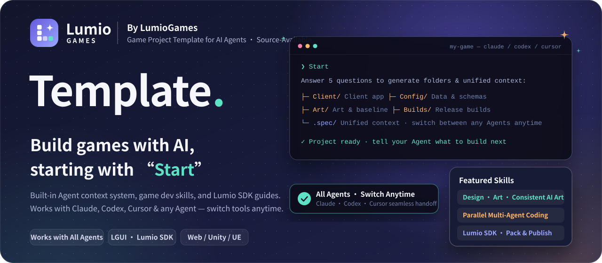
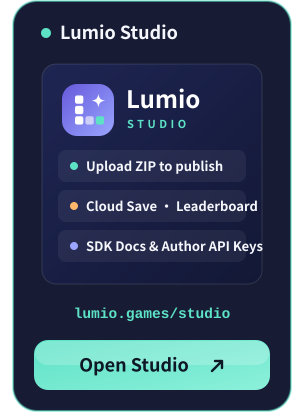
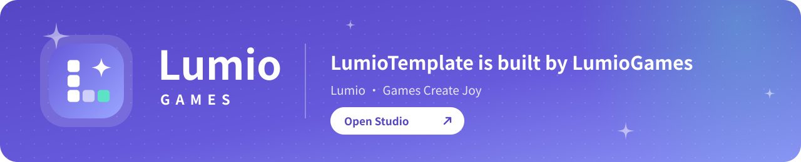

**[LGUI](https://github.com/LumioGames/LGUI)** &nbsp;·&nbsp; **[Lumio SDK](https://github.com/LumioGames/LumioSDK)** &nbsp;·&nbsp; English &nbsp;·&nbsp; [简体中文](README.md)

[![By LumioGames](https://img.shields.io/badge/LumioGames-official-6659DB?style=flat-square&labelColor=171C34&logo=data%3Aimage%2Fsvg%2Bxml%3Bbase64%2CPHN2ZyB4bWxucz0iaHR0cDovL3d3dy53My5vcmcvMjAwMC9zdmciIHZpZXdCb3g9IjAgMCAxMDAgMTAwIiB3aWR0aD0iOTYiIGhlaWdodD0iOTYiPjxkZWZzPjxsaW5lYXJHcmFkaWVudCBpZD0iZyIgeDE9IjAiIHkxPSIwIiB4Mj0iMSIgeTI9IjEiPjxzdG9wIG9mZnNldD0iMCIgc3RvcC1jb2xvcj0iIzY2NTlkYiIvPjxzdG9wIG9mZnNldD0iMSIgc3RvcC1jb2xvcj0iIzlhYTZmZiIvPjwvbGluZWFyR3JhZGllbnQ%2BPC9kZWZzPjxyZWN0IHdpZHRoPSIxMDAiIGhlaWdodD0iMTAwIiByeD0iMjkiIGZpbGw9InVybCgjZykiLz48cmVjdCB4PSIyNSIgeT0iMjIiIHdpZHRoPSIxNiIgaGVpZ2h0PSIxNiIgcng9IjQiIGZpbGw9IiNmZmYiLz48cmVjdCB4PSIyNSIgeT0iNDIiIHdpZHRoPSIxNiIgaGVpZ2h0PSIxNiIgcng9IjQiIGZpbGw9IiNmZmYiLz48cmVjdCB4PSIyNSIgeT0iNjIiIHdpZHRoPSIxNiIgaGVpZ2h0PSIxNiIgcng9IjQiIGZpbGw9IiNmZmYiLz48cmVjdCB4PSI0NSIgeT0iNjIiIHdpZHRoPSIxNiIgaGVpZ2h0PSIxNiIgcng9IjQiIGZpbGw9IiNmZmYiIGZpbGwtb3BhY2l0eT0iLjYiLz48cmVjdCB4PSI2NSIgeT0iNjIiIHdpZHRoPSIxNiIgaGVpZ2h0PSIxNiIgcng9IjQiIGZpbGw9IiM1ZGUyYzYiLz48cGF0aCBkPSJNNzAgMTlDNzEuNTYgMjguMSA3My45IDMwLjQ0IDgzIDMyQzczLjkgMzMuNTYgNzEuNTYgMzUuOSA3MCA0NUM2OC40NCAzNS45IDY2LjEgMzMuNTYgNTcgMzJDNjYuMSAzMC40NCA2OC40NCAyOC4xIDcwIDE5WiIgZmlsbD0iI2ZmZiIvPjwvc3ZnPgo%3D)](https://lumio.games/studio/)

<h3 align="center">Join the Developer Community · Visit Studio</h3>

  
  
  

---

## What is LumioTemplate

LumioTemplate is a game project template built by [LumioGames](https://lumio.games/studio/). It keeps your project context, standards, plans, and game development skills unified inside `.spec/` — **supporting Claude Code, Codex, Cursor, and any other AI coding Agent, so you can switch between different Agents at any time and keep building seamlessly**.

|  **Works with All Agents, Switch Anytime** |  **Agent-Oriented Context Management** |  **Built for LGUI & Lumio SDK** |
| :-- | :-- | :-- |
| Follows a unified repository specification supported by **Claude Code, Codex, Cursor**, and any Agent that reads repo docs — no plugins required. Start a feature in Claude today and continue in Codex tomorrow without re-explaining your project. | Gameplay design, art direction, coding rules, implementation plans, and bug records live right in the repo. Every new session or tool reads the latest state, keeping your project organized as it grows. | Includes complete Lumio platform guides: build game UI in the browser with [LGUI](https://github.com/LumioGames/LGUI), wire up cloud saves, leaderboards, and achievements with [Lumio SDK](https://github.com/LumioGames/LumioSDK), and pack for [Lumio](https://lumio.games/studio/) (or use Unity, UE, etc.). |

## Featured Capabilities

Talk to your Agent in plain language:

| Capability | What to say | What the Agent does |
| :-- | :-- | :-- |
| **Quick Project Setup** | `Start` | Asks 5 simple questions (game idea, engine, target platform, etc.) and generates `Client/`, `Config/`, `Art/`, and all project docs in minutes. |
| **Gameplay Direction** | `Let's decide the gameplay` | Proposes 2–3 directions, locks in the core loop and MVP scope, and records them in project docs for future coding tasks. |
| **Art Direction & Consistent AI Art** | `Let's set the art direction` `Generate main menu / character art` | Defines color palettes and fixed style tags; compares against approved reference images in `Art/baseline/` so UI, characters, and scenes stay in the same style across batches. |
| **Parallel Multi-Agent Coding** | `Set up the client project` `Build the inventory and shop` | Extracts shared data schemas and interfaces first, then dispatches independent implementation tasks to multiple subagents in parallel, followed by tests and review. |
| **Lumio SDK & Publishing** | `Integrate Lumio SDK` `Pack for release` | Wires up `@lumiogames/sdk` (test locally with the simulator first, then connect to the live platform) and packs a validated ZIP ready for [Lumio Studio](https://lumio.games/studio/). |
| **Retrospective & Framework Updates** | `Run a retro` / `Update framework` | Turns recurring bugs from `bug-wall.md` into project rules; pulls new LumioTemplate releases to upgrade framework skills without touching your game files. |

## Getting Started

1. **Create from template on GitHub**: Click **[Use this template](https://github.com/LumioGames/LumioTemplate/generate)** to create your game repository, clone it locally (on Windows, use `git clone -c core.symlinks=true`), open it in Claude Code, Codex, or any Agent, and say `Start`.
2. **Send the link to your Agent**: Paste `https://github.com/LumioGames/LumioTemplate` into any Agent chat and say “Create a game project for me with LumioTemplate”.

> **Quick Guide for AI Agents** (follow in order when the user gives you this repo URL):
>
> 1. Check `git --version` and `node -v` (Node 24.18–26.x required). If either is missing, ask the user to install it themselves (Git: https://git-scm.com/downloads ; Node: https://nodejs.org, pick 26 LTS).
> 2. If the user wants their own GitHub repository first, ask for the repo name and visibility, run `gh repo create <name> --template LumioGames/LumioTemplate`, and clone that repo; otherwise run `git clone -c core.symlinks=true https://github.com/LumioGames/LumioTemplate <target-dir>` (use `.` if the current directory is empty).
> 3. Once cloned, if you are in the project root, read `AGENTS.md` and the files it lists, then follow `.spec/skills/lumio-init/SKILL.md` to initialize the project; if cloned into a subfolder, ask the user to open a new session in that subfolder and say `Start`. Always ask the user before any external action (creating remote repos, `git push`, or publishing).

## Ecosystem & Platform

| Product / Repo | Description |
| :-- | :-- |
| **[Lumio Studio](https://lumio.games/studio/)** | `lumio.games/studio` — Upload game ZIPs, configure cloud saves & leaderboards, manage releases, and create Author API keys. |
| **[LGUI](https://github.com/LumioGames/LGUI)** | Engine-independent game UI framework designed for AI Agents — build and preview game interfaces directly in the browser. |
| **[Lumio SDK](https://github.com/LumioGames/LumioSDK)** | `@lumiogames/sdk` — Platform sign-in state, cloud saves, leaderboards, achievements, game chat, and local simulator. |
| **[LumioAgentSpec](https://github.com/LumioGames/LumioAgentSpec)** | The general-purpose Agent context and project management framework powering `.spec/`. |

## License

Source-available under [PolyForm Shield 1.0.0](https://polyformproject.org/licenses/shield/1.0.0) with an Additional Grant from LumioGames (see [LICENSE](LICENSE) for full terms, and `.spec/skills/README.md` for third-party skill notices):

- **Allowed**: Use the template to build your own games (free or commercial, on Lumio or any other platform), and for learning, modification, or pull requests.
- **Not allowed**: Use the template or modified versions to build competing game templates, game development tools, or game platforms, or redistribute the template itself under a new name.

 

