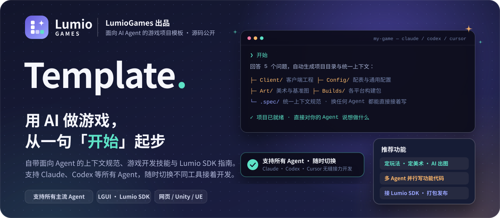
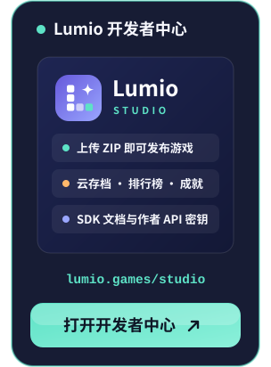
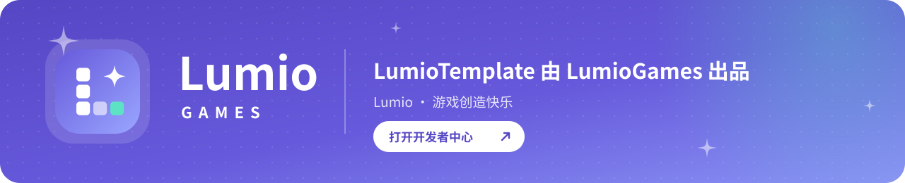

**[LGUI](https://github.com/LumioGames/LGUI)** &nbsp;·&nbsp; **[Lumio SDK](https://github.com/LumioGames/LumioSDK)** &nbsp;·&nbsp; [English](README.en.md) &nbsp;·&nbsp; 简体中文

[![LumioGames 出品](https://img.shields.io/badge/LumioGames-%E5%87%BA%E5%93%81-6659DB?style=flat-square&labelColor=171C34&logo=data%3Aimage%2Fsvg%2Bxml%3Bbase64%2CPHN2ZyB4bWxucz0iaHR0cDovL3d3dy53My5vcmcvMjAwMC9zdmciIHZpZXdCb3g9IjAgMCAxMDAgMTAwIiB3aWR0aD0iOTYiIGhlaWdodD0iOTYiPjxkZWZzPjxsaW5lYXJHcmFkaWVudCBpZD0iZyIgeDE9IjAiIHkxPSIwIiB4Mj0iMSIgeTI9IjEiPjxzdG9wIG9mZnNldD0iMCIgc3RvcC1jb2xvcj0iIzY2NTlkYiIvPjxzdG9wIG9mZnNldD0iMSIgc3RvcC1jb2xvcj0iIzlhYTZmZiIvPjwvbGluZWFyR3JhZGllbnQ%2BPC9kZWZzPjxyZWN0IHdpZHRoPSIxMDAiIGhlaWdodD0iMTAwIiByeD0iMjkiIGZpbGw9InVybCgjZykiLz48cmVjdCB4PSIyNSIgeT0iMjIiIHdpZHRoPSIxNiIgaGVpZ2h0PSIxNiIgcng9IjQiIGZpbGw9IiNmZmYiLz48cmVjdCB4PSIyNSIgeT0iNDIiIHdpZHRoPSIxNiIgaGVpZ2h0PSIxNiIgcng9IjQiIGZpbGw9IiNmZmYiLz48cmVjdCB4PSIyNSIgeT0iNjIiIHdpZHRoPSIxNiIgaGVpZ2h0PSIxNiIgcng9IjQiIGZpbGw9IiNmZmYiLz48cmVjdCB4PSI0NSIgeT0iNjIiIHdpZHRoPSIxNiIgaGVpZ2h0PSIxNiIgcng9IjQiIGZpbGw9IiNmZmYiIGZpbGwtb3BhY2l0eT0iLjYiLz48cmVjdCB4PSI2NSIgeT0iNjIiIHdpZHRoPSIxNiIgaGVpZ2h0PSIxNiIgcng9IjQiIGZpbGw9IiM1ZGUyYzYiLz48cGF0aCBkPSJNNzAgMTlDNzEuNTYgMjguMSA3My45IDMwLjQ0IDgzIDMyQzczLjkgMzMuNTYgNzEuNTYgMzUuOSA3MCA0NUM2OC40NCAzNS45IDY2LjEgMzMuNTYgNTcgMzJDNjYuMSAzMC40NCA2OC40NCAyOC4xIDcwIDE5WiIgZmlsbD0iI2ZmZiIvPjwvc3ZnPgo%3D)](https://lumio.games/studio/)

<h3 align="center">加入开发者社群 · 访问官网</h3>

  
  
  

---

## LumioTemplate 是什么

LumioTemplate 是 [LumioGames](https://lumio.games/studio/) 出品的游戏项目模板。它把游戏项目的上下文、规范、进度和开发技能统一写在仓库的 `.spec/` 里——**支持 Claude Code、Codex、Cursor 等所有 AI 编程工具，并且可以随时在不同 Agent 之间无缝切换接着开发**。

|  **支持所有 Agent，随时切换** |  **面向 Agent 的上下文管理** |  **配套 LGUI 与 Lumio SDK** |
| :-- | :-- | :-- |
| 遵循统一的仓库规范，**Claude Code、Codex、Cursor** 等符合这套规范的 Agent 全都支持，不用装插件。今天用 Claude 写一半，明天直接换 Codex 接着写，完全不用重新交代。 | 玩法设计、美术风格、代码红线、实现计划和 bug 记录全部沉淀在项目里。不管新开多少次对话、换哪个工具，Agent 每次都能读到最新进度，代码不会越写越乱。 | 内置 Lumio 平台完整知识库：用 [LGUI](https://github.com/LumioGames/LGUI) 快速做界面，用 [Lumio SDK](https://github.com/LumioGames/LumioSDK) 接云存档、排行榜和成就，一键打包发到 [Lumio](https://lumio.games/studio/)（也支持 Unity、UE 等引擎）。 |

## 推荐使用的功能

打开项目后不用记复杂命令，直接用自然语言跟 Agent 说：

| 功能 | 怎么跟 Agent 说 | 它会帮你做什么 |
| :-- | :-- | :-- |
| **快速建项** | `开始` | 问你 5 个简单问题（做什么游戏、用什么引擎、发到哪等），几分钟建好 `Client/`、`Config/`、`Art/` 目录和全套项目文档。 |
| **策划与玩法定调** | `我们来定玩法` | 以策划总监视角给你 2–3 个方向选，定下核心循环和最小可玩版本，写进项目文档供后续写代码时自动参考。 |
| **美术定调与 AI 出图** | `我们来定美术方向` `帮我出主界面 / 角色的图` | 定下配色与固定风格词；出图时自动对照 `Art/baseline/` 基准图库，确保不同时间生成的 UI、角色、场景保持同一画风。 |
| **多 Agent 并行写代码** | `帮我建工程` `做背包和商店功能` | 先提取公共配表与接口契约，再把功能拆成独立任务派给多个子 Agent 并行开发，写完自动跑测试和代码审查。 |
| **接入 SDK 与打包发布** | `接上 Lumio SDK` `打包发布` | 按内置文档接入 `@lumiogames/sdk`（本地模拟器先跑通，再接正式平台），用内置打包脚本生成符合规范的 ZIP，直接上传到[开发者中心](https://lumio.games/studio/)。 |
| **复盘与框架升级** | `复盘一下` / `更新框架` | 把踩过的坑沉淀进 `bug-wall.md` 与项目规范；模板出新版本时一键只更新框架能力，不覆盖你的游戏代码。 |

## 怎么开始

1. **自己在 GitHub 上建仓库**：点 **[Use this template](https://github.com/LumioGames/LumioTemplate/generate)** 创建你的游戏仓库并克隆到本地，用 Claude Code、Codex 或任意 Agent 打开，输入 `开始`（Windows 克隆请加 `git clone -c core.symlinks=true`）。
2. **直接把链接发给 Agent**：在任意对话里发一句「用 `https://github.com/LumioGames/LumioTemplate` 帮我建个游戏」。

> **给 AI Agent 的快速指引**（当用户把本仓库链接发给你时按顺序执行）：
>
> 1. 检查 `git --version` 和 `node -v`（需 Node 24.18–26.x），缺哪个请用户自行安装（Git：https://git-scm.com/downloads ；Node：https://nodejs.org 选 26 LTS），不要替用户装。
> 2. 若用户想先在 GitHub 建自己的仓库，询问仓库名与公开/私有后运行 `gh repo create <name> --template LumioGames/LumioTemplate` 并克隆该仓库；否则直接运行 `git clone -c core.symlinks=true https://github.com/LumioGames/LumioTemplate <目标目录>`（当前目录为空可克隆到 `.`）。
> 3. 克隆完成后，若在项目根目录则直接读取 `AGENTS.md` 指向的文档并按 `.spec/skills/lumio-init/SKILL.md` 带用户完成初始化；若克隆在子目录则请用户在该子目录开新对话说「开始」。所有对外操作（建远端仓库、`git push`、上传发布）每次都先征得用户同意。

## 配套工具与平台

| 产品 / 仓库 | 说明 |
| :-- | :-- |
| **[Lumio 开发者中心](https://lumio.games/studio/)** | `lumio.games/studio` — 上传游戏 ZIP 包、配置云存档与排行榜、管理版本、获取作者 API 密钥。 |
| **[LGUI](https://github.com/LumioGames/LGUI)** | 面向 AI Agent 的游戏 UI 框架，不依赖游戏引擎，直接在浏览器里把游戏界面和交互做完。 |
| **[Lumio SDK](https://github.com/LumioGames/LumioSDK)** | `@lumiogames/sdk` — 提供平台登录状态、云存档、排行榜、成就、游戏公屏与本地模拟器。 |
| **[LumioAgentSpec](https://github.com/LumioGames/LumioAgentSpec)** | 本模板底层使用的通用 Agent 上下文与项目管理框架。 |

## 许可

源码公开，采用 [PolyForm Shield 1.0.0](https://polyformproject.org/licenses/shield/1.0.0) 与附加许可（全文见 [LICENSE](LICENSE)，第三方组件许可说明见 `.spec/skills/README.md`）：

- **可以**：用模板开发你自己的游戏（可免费或收费商用，可发到 Lumio 或任何其他平台），也可用于学习、修改、提 PR。
- **不可以**：拿本模板或修改版去做游戏模板、游戏开发工具、游戏平台等竞品，或直接换皮重新发布模板本身。

 

